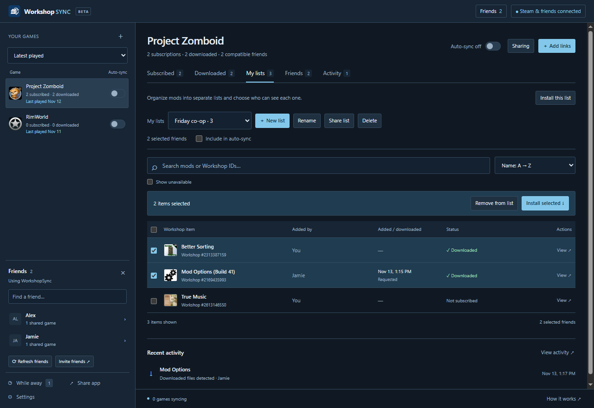

# WorkshopSync

WorkshopSync is a Windows companion for sharing and synchronizing Steam Workshop mods with friends. It works with subscriptions and named lists, without requiring Steam Collections or favorites.

**Current desktop release: v0.10.3 · License: GPL-3.0-only**

[Download the Windows installer](https://workshopsync.pages.dev/download) · [Releases](https://github.com/Roxas27x/WorkshopSync/releases) · [Player guide](workshop-link/README.md) · [Report a bug](https://github.com/Roxas27x/WorkshopSync/issues)



## Features

- Browse connected Steam friends' shared subscriptions and named mod lists, grouped by game.
- Choose individual friends or groups, share separate named lists, and opt into automatic downloads per game.
- Search Steam Workshop inside the app, with most subscribed results loaded automatically and game-specific type filters.
- Subscribe privately, subscribe and share, or save items to a list.
- Read full mod descriptions in nested popups and review the nested requirement and recommendation tree in one step. Steam download authorization is checked before review and installation; reconnecting preserves your reviewed choices.
- See download status, sizes, dates, and attribution. Sort by size to find large mods.
- Delete selected mods with a separate confirmation. Deleted mods can be blacklisted from auto-sync; explicit reinstalls clear the blacklist when detected.
- Receive verified installer updates through the app and choose when to restart.
- Use the Utility layout with multiple palettes and light, dark, or system appearance.

Automatic synchronization is opt-in. Subscription sharing defaults on after connecting friends and can be configured per game and list. Author notes provide guidance; they do not prove that a set of mods is compatible.

## Repository layout

| Folder | Purpose |
| --- | --- |
| `workshop-link/` | Electron desktop app, installer configuration, and desktop tests |
| `workshop-sync-service/` | Steam OpenID friend-sync server, SQLite migrations, and release service |
| `workshopsync-site/` | Cloudflare Pages download website and download proxy |
| `scripts/` | Public-source checks and UI test runner |
| `docs/` | Hosting, release, and contribution documentation |

The `workshop-link` folder and Windows profile name preserve compatibility with existing WorkshopSync installations. The product name is WorkshopSync.

## Run from source

Use Windows x64 and Node.js 24 LTS for the desktop app. The server and website tests also run on Node.js 24. Live hosting uses Railway's Bun runtime and a persistent SQLite volume.

```powershell
git clone https://github.com/Roxas27x/WorkshopSync.git
cd WorkshopSync
npm --prefix workshop-link ci
npm --prefix workshop-sync-service ci
npm test
npm --prefix workshop-link start
```

To build the Windows installer:

```powershell
npm --prefix workshop-link run installer
```

The installer is written under `workshop-link/installer/`. New builds include the GPL license and npm dependency license notices. The `package.json` files use `private: true` to prevent accidental npm publishing; the GitHub source is public and GPL licensed.

To preview the website:

```powershell
npm --prefix workshopsync-site run preview
```

The preview listens on `http://localhost:8788`. See [hosting and forks](docs/HOSTING.md) for service and website deployment.

## Tests

`npm test` runs the desktop unit tests, server tests with in-memory SQLite and synthetic accounts, and website tests. It does not subscribe to, unsubscribe from, or delete your Steam mods. The file deletion tests create and remove only their temporary test directories.

```powershell
npm run test:ui
npm run check:public
```

The UI check uses a separate sample profile and mocked Steam actions. Scripts named `installed-*` and `live-*` in `workshop-link/tests/` are optional maintainer integration tools; they can inspect or change an installed app and are excluded from the default test commands.

## Release and privacy information

The public repository contains the source for desktop v0.10.3, the sync server, and the website. The [runtime source manifest](docs/runtime-source-v0.10.0.json) records the exact runtime files used for the existing official installer. Version 0.10.1 added GPL notices, documentation, and license packaging without changing those runtime files. Version 0.10.2 fixes friend discovery when a saved Steam Community session expires and prevents failed friend refreshes from erasing the published roster.

Public service URLs and the public Ed25519 update-verification key are intentionally included. Private signing keys, Steam cookies, companion sessions, personal mod lists, deployed databases, logs, and hosting credentials are excluded. Publishing official updates still requires the authorized publisher account and its protected private signing key.

The website is hosted on Cloudflare Pages. The friend-sync API and installer store are hosted separately on Railway. See [release information](docs/RELEASING.md) before producing a fork or operating an update service.

## License and attribution

Original WorkshopSync code and original artwork are licensed under **GNU GPL version 3 only**. See [LICENSE](LICENSE). Dependencies, Steam/game artwork, and screenshots containing third-party assets retain their own licenses and ownership; see [third-party notices](THIRD_PARTY_NOTICES.md).

Copyright © 2026 Roxas27x and WorkshopSync contributors.

WorkshopSync is an independent project, unaffiliated with Valve or the developers of games shown in the app. Steam manages Workshop subscriptions and downloads. WorkshopSync does not bypass game ownership, private-item access, or Steam sign-in requirements.
